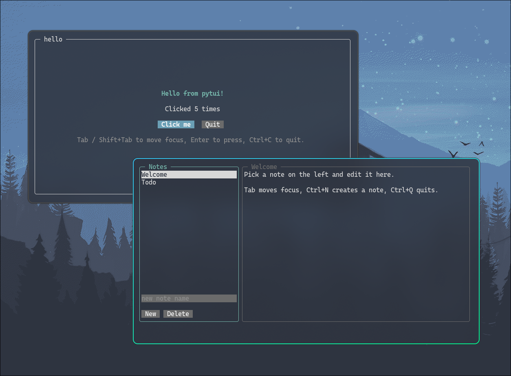

# pytui



Build terminal user interfaces in Python with ideas borrowed from HTML/CSS:
a tree of widgets, typed styles, and a flexbox layout engine.

- **Flexbox layout** with percentages, min/max sizes, borders, absolute positioning and scrolling.
- **Styles as objects**, merged with `|`, with inherited text attributes and
  `hover` / `focus` / `disabled` variants.
- **One building block**: everything is a `Widget`; `Row`, `Column`, `Text`, `Button`,
  `Checkbox`, `TextArea` and `ProgressBar` are small helpers built from it.
- **Keyboard, mouse and paste input**, with focus navigation and key bindings.
- **Efficient rendering**: only changed cells are written; wide characters are handled.
- **Testable**: render to text and simulate input without a terminal.
- **Zero dependencies**, pure Python >= 3.11 (Linux/macOS).

**Documentation: [the wiki](https://github.com/gdamms/pytui/wiki)**

## Install

```sh
git clone https://github.com/gdamms/pytui.git
uv add pytui
```

## Quick start

```python
from pytui import App, Box, Button, Row, Text

count = Text("Clicked 0 times")
clicks = 0

def on_click(event):
    global clicks
    clicks += 1
    count.text = f"Clicked {clicks} times"

app = App(
    Box(
        Text("Hello from pytui!", bold=True, fg="cyan"),
        count,
        Row(Button("Click me", on_click=on_click), Button("Quit", on_click=lambda e: app.exit()), gap=2),
        border="rounded", padding=(1, 2), gap=1,
        align_items="center", justify_content="center",
    )
)
app.run()
```

More in [`examples/`](examples): `uv run examples/notes.py`, `uv run examples/dashboard.py`.

## Docs

The [wiki](https://github.com/gdamms/pytui/wiki) is generated from [`docs/`](docs) and the
docstrings on every release. Edit those rather than the wiki, which is overwritten. To preview:

```sh
uv run --group docs sphinx-build -b markdown docs docs/_build/wiki
```
