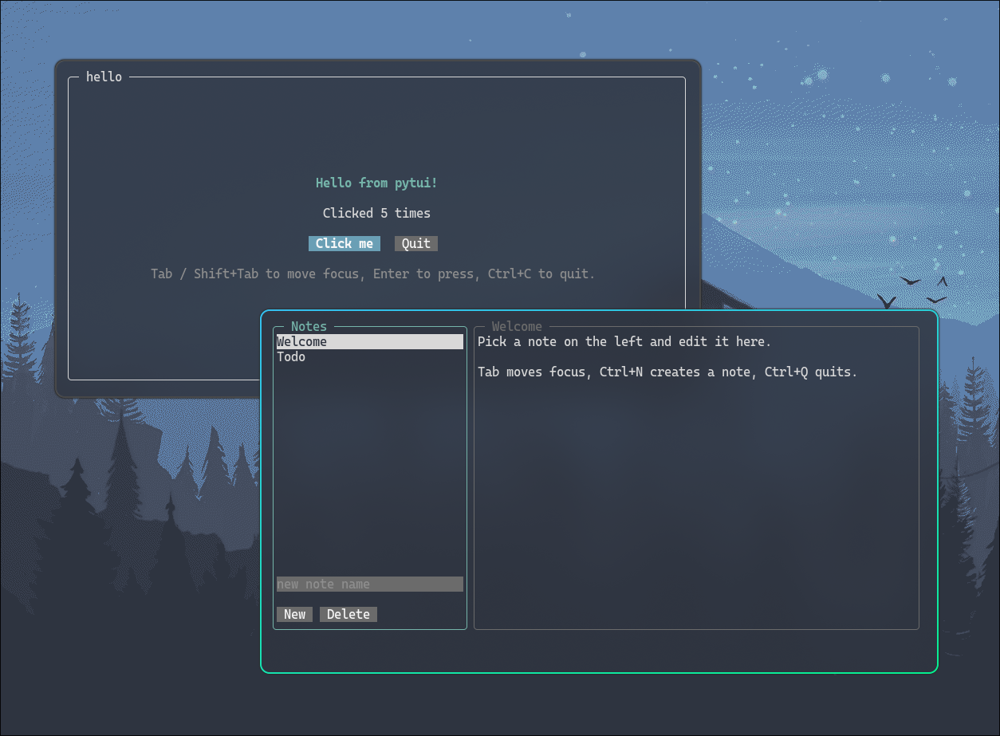

# pytui



Build terminal user interfaces in Python with ideas borrowed from HTML/CSS:
a tree of widgets, typed styles, and a flexbox layout engine.

- **Flexbox layout**: `direction`, `flex_grow`/`flex_shrink`, `gap`, `justify_content`,
  `align_items`, percentages, min/max sizes, margins, padding, borders, absolute positioning,
  scrollable containers.
- **Styles as objects**: `Style(...)` merged with `|`, inherited text attributes, and
  `hover` / `focus` / `focus_within` / `disabled` state variants.
- **One building block**: everything is a `Widget` (a styled box that shows text, holds state,
  contains children and reacts to input). `Row`, `Column`, `Text`, `Button`, `Checkbox`,
  `TextArea` and `ProgressBar` are small helpers built from it.
- **Input**: keyboard with modifiers, mouse (click, drag, hover, wheel), bracketed paste,
  focus navigation with Tab.
- **Efficient rendering**: an in-memory cell buffer diffed against the previous frame, so only
  changed cells are written. Wide (CJK/emoji) characters are handled.
- **Testable**: render to text and simulate input without a terminal.
- **Zero dependencies**, pure Python >= 3.11 (Linux/macOS). (Might work with lower Python versions, but not tested.)

## Install

```sh
git clone https://github.com/gdamms/pytui.git
uv add pytui
```

One day, I'll publish it to PyPI...

## Quick start

```python
from pytui import App, Box, Button, Row, Text

count = Text("Clicked 0 times")
clicks = 0

def on_click(event):
    global clicks
    clicks += 1
    count.text = f"Clicked {clicks} times"

app = App(
    Box(
        Text("Hello from pytui!", bold=True, fg="cyan"),
        count,
        Row(Button("Click me", on_click=on_click), Button("Quit", on_click=lambda e: app.exit()), gap=2),
        border="rounded", padding=(1, 2), gap=1,
        align_items="center", justify_content="center",
    )
)
app.run()
```

The screen is redrawn automatically after every event, timer or thread callback, so
changing widget attributes (`count.text = ...`) is all it takes to update the UI.

Try the examples:

```sh
uv run examples/hello.py      # from the quick start
uv run examples/notes.py      # list + editor, key bindings, focus styles
uv run examples/dashboard.py  # timers, background thread, scrolling log
```

## Layout

Every widget is a flex container, like `display: flex` in CSS. Children are laid out along the
main axis (`direction`, default `"column"`) and aligned on the cross axis.

| Property | Values | Default |
| --- | --- | --- |
| `width`, `height` | `int` cells, `"50%"` of the parent, `"auto"` | `"auto"` (fit content) |
| `min_width`, `max_width`, `min_height`, `max_height` | same | none |
| `box_sizing` | `"border-box"`, `"content-box"` | `"border-box"` |
| `margin`, `padding` | `1`, `(vertical, horizontal)`, `(top, right, bottom, left)` | `0` |
| `border` | `"none"`, `"single"`, `"double"`, `"rounded"`, `"heavy"`, `"ascii"`, `"blank"` or 8 custom chars | `"none"` |
| `direction` | `"row"`, `"column"` | `"column"` |
| `gap` | `int` | `0` |
| `justify_content` | `"start"`, `"center"`, `"end"`, `"space-between"`, `"space-around"`, `"space-evenly"` | `"start"` |
| `align_items` | `"start"`, `"center"`, `"end"`, `"stretch"` | `"stretch"` |
| `align_self` | `"auto"` or an `align_items` value | `"auto"` |
| `flex_grow`, `flex_shrink` | `float` | `0`, `1` |
| `position` | `"relative"`, `"absolute"` (with `top`/`right`/`bottom`/`left`) | `"relative"` |
| `display` | `"flex"`, `"none"` (removed from layout) | `"flex"` |
| `visibility` | `"visible"`, `"hidden"` (keeps its space) | `"visible"` |
| `overflow` | `"hidden"`, `"visible"`, `"scroll"` | `"hidden"` |

```python
Row(
    Box(sidebar, width=30, flex_shrink=0, border="rounded"),
    Box(editor, flex_grow=1, border="rounded"),               # takes the remaining space
    Box(help_panel, width="25%", display="none", id="help"),  # toggled later
)
```

Absolute children are positioned in the parent's padding box but may draw over its border,
which is how you give a box a title:

```python
Box(Text(" Files ", position="absolute", top=-1, left=1), sidebar, border="rounded")
```

`overflow="scroll"` makes a container scrollable. Its children keep their natural size, and it
scrolls with the mouse wheel, with the keyboard when it is focusable (`focusable=True`), and
automatically to reveal the focused widget. A scrollbar is drawn on the right border, or in a
reserved column if there is no border.

## Styling

Style fields can be passed as keyword arguments or as a `Style` object. Styles combine with
`|`, and the right-hand side wins:

```python
from pytui import Style

card = Style(border="rounded", padding=(0, 1), border_fg="bright_black")
active = card | Style(border_fg="cyan", bold=True)

Box(Text("hello"), style=card, margin=1)  # keywords are merged on top of `style`
widget.set_style(fg="red")                # change it later
```

- **Text attributes** `fg`, `bg`, `bold`, `dim`, `italic`, `underline`, `strike`, `reverse`,
  `text_align`, `text_wrap` are **inherited** by children.
- **Colors**: names (`"red"`, `"bright_blue"`, `"gray"`, `"default"`), `"#rrggbb"`, or a
  256-color index.
- **States** are nested styles applied while the state is active:

```python
Button("Save", style=Style(
    bg="green",
    hover=Style(bg="bright_green"),
    focus=Style(bold=True, underline=True),
    disabled=Style(dim=True),
))
Box(..., focus_within=Style(border_fg="cyan"))  # when a descendant has focus
```

Each widget class has a `DEFAULT_STYLE` that instance styles override. To theme a widget
everywhere, subclass it:

```python
class DangerButton(Button):
    DEFAULT_STYLE = Button.DEFAULT_STYLE | Style(bg="red", focus=Style(bg="bright_red"))
```

## Widgets

Everything on screen is a `Widget`:

```python
Widget(*children, text="", on_click=None, on_key=None, on_change=None, **style)
```

- **`text` is a background**: it is painted inside the box (wrapped unless `text_wrap=False`,
  aligned with `text_align`) and the children are laid out on their own, over it. The two only
  interact through size: the widget is as big as whichever needs more room. Empty text takes no
  space.
- **Strings among the children become `Text` widgets**: `Column("a", "b")` shows two lines.
- **`value` is the state** of the widget (`checkbox.value.checked`, `textarea.value.text`,
  `bar.value.progress`). Assigning a field, from your code or from input, calls `on_change`.
- **`cursor`** (`None` by default) is a caret or selection in `text`, drawn while focused.

The helpers are presets and compositions of `Widget`:

| Helper | What it is | State |
| --- | --- | --- |
| `Box` | `Widget` itself | |
| `Row(*children)`, `Column(*children)` | `direction` preset | |
| `Text(text)` | `Widget(text=text)` | |
| `Button(*children)` | Focusable, Enter and Space count as a click | |
| `Checkbox(*children, checked=False)` | A `[x]` mark followed by its children, toggled by click, Enter or Space | `value.checked` |
| `TextArea(text="", placeholder="")` | Editor with word/line shortcuts, Shift+arrows selection and a dimmed placeholder | `value.text` |
| `ProgressBar(progress=0.0)` | A `━━━━━━━━━━` bar, progress between 0 and 1 | `value.progress` |

```python
Button("Save", on_click=lambda event: save())
Checkbox("Dark mode", on_change=lambda event: set_theme(event.value))
name = TextArea(placeholder="your name", height=1, text_wrap=False)
name.bind("enter", lambda: greet(name.value.text))  # a single-line field
```

There is no list widget and no "selected" state: build lists from plain widgets and highlight
items by changing their style (`item.set_style(reverse=True)`), as `examples/notes.py` does.

Common widget API: `id=`, `disabled=`, `focusable=`, `mount(*children)`, `remove()`,
`clear()`, `find(id)`, `get(id, Type)`, `walk()`, `focus()`, `click()`, `hidden = True`,
`bind(key, fn)`, `scroll_to()`, and `region` / `content_region` (screen rectangles after layout).

## Events, focus and key bindings

Every widget accepts the same callbacks, which receive an event:

| Callback | Event | Fields |
| --- | --- | --- |
| `on_click` | `ClickEvent` | `widget` (clicked), `mouse` (`None` when triggered by the keyboard) |
| `on_key` | `KeyEvent` | `key`, `char`, `ctrl`, `alt`, `shift` |
| `on_change` | `ChangeEvent` | `widget` (whose value changed), `name`, `value`, `old` |

- Events bubble up from the focused widget (keys), the widget under the pointer (clicks) or the
  widget whose value changed. A callback stops the event only by **returning `True`**, so
  callbacks that just observe are safe.
- For each key press, at each widget: its key bindings run first, then your `on_key`, then the
  widget's built-in behaviour. Return `True` from `on_key` to override a built-in. Then come
  app bindings, and Tab / Shift+Tab move focus if nothing handled the key.
- A change first runs the widget's built-in reaction (e.g. `TextArea` repaints its text), then
  your `on_change`, then bubbles: `Column(*checkboxes, on_change=...)` observes the whole group.
- A mouse press focuses the nearest focusable widget, and press+release on the same widget is
  a click.
- Key names look like `"a"`, `"A"`, `"+"`, `"space"`, `"enter"`, `"escape"`, `"tab"`,
  `"shift+tab"`, `"up"`, `"pageup"`, `"f5"`, `"ctrl+s"`, `"alt+x"`, `"ctrl+shift+left"`,
  `"ctrl++"`. Modifiers are case-insensitive, `esc`, `return`, `del`, `pgup`, `pgdn` and `plus`
  are accepted as aliases, and unknown names raise `ValueError`.

```python
app.bind("ctrl+q", app.exit)                      # global
editor.bind("ctrl+s", save)                       # only while focus is inside `editor`
app.bind("f1 ctrl+h", lambda: help.set_style(display="flex"))
```

`ctrl+c` exits by default (`app.unbind("ctrl+c")` to disable). `app.run()` returns the value
passed to `app.exit(value)`.

## Timers and threads

```python
timer = app.set_interval(1.0, update_clock)  # timer.cancel() to stop
app.call_later(0.5, lambda: status.set_style(display="none"))

def worker():                                # in another thread
    result = slow_computation()
    app.call_from_thread(show_result, result)  # thread-safe, redraws afterwards
```

## Custom widgets

Subclass `Widget`, keep the state in a `Value`, and put the built-in behaviour in the `handle_*`
methods (`handle_key`, `handle_click`, `handle_change`, `handle_mouse`, `handle_paste`,
`handle_focus`, `handle_blur`). They run after the user's callbacks (except `handle_change`,
which runs first) and stop the event unless they return `False`:

```python
from pytui import Style, Value, Widget

class CounterValue(Value):
    count: int = 0

class Counter(Widget):
    FOCUSABLE = True
    DEFAULT_STYLE = Style(padding=(0, 1), focus=Style(reverse=True))

    def __init__(self, **kwargs):
        super().__init__(**kwargs)
        self.value = CounterValue()

    def handle_change(self, event) -> bool:
        if event.widget is self:
            self.text = f"count: {event.value}"
        return False  # let the change bubble up

    def handle_key(self, event) -> bool:
        if event.key in ("up", "+"):
            self.value.count += 1
            return True  # handled: stop propagation
        if event.key in ("down", "-"):
            self.value.count -= 1
            return True
        return super().handle_key(event)
```

Background, border, text, cursor, children and clipping are handled for you. For content that
is not text, override `content_width`, `content_height` and `render(canvas)`.

## Testing your UI

No terminal needed: render to text and simulate input.

```python
def test_login_form():
    name = TextArea(id="name", height=1)
    submitted = []
    app = App(Box(name, Button("Login", on_click=lambda e: submitted.append(name.value.text))))

    app.render(40, 5)
    app.feed("alice")          # raw terminal input: text, escape sequences, mouse reports
    app.press("tab", "enter")  # key names
    assert submitted == ["alice"]
    assert "alice" in app.snapshot()
    app.click(0, 1)            # mouse click at screen coordinates
```

To write frames to a file instead of a terminal, give the app's canvas a `FileScreen`:

```python
app.canvas.screen = FileScreen("frame.txt")  # colors=True keeps styles as ANSI codes
app.render(80, 24)
app.canvas.present()                         # frame.txt now holds the UI
app.press("tab")
app.canvas.present()                         # rewritten with the new frame
```
